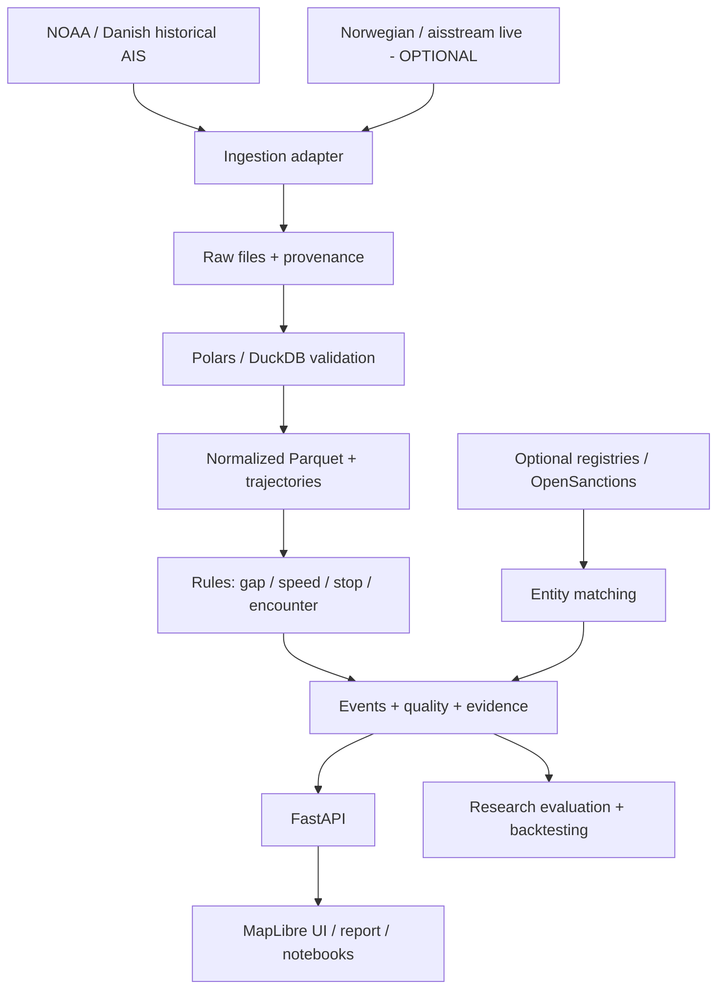

# Maritime Anomaly Intelligence Engine

> **Project blueprint / research brief / agent context**  
> Версия: 1.0 · Дата проверки источников: **13 ноября 2026**  
> Статус: концепция и план, **не готовая реализация**  
> Цель: подготовить основу для brainstorming с coding/research агентом и дальнейшей разработки open-source pet project на Python.

---

## 0. TL;DR и главное решение

**Идея:** построить воспроизводимую аналитическую систему по данным AIS (Automatic Identification System), которая восстанавливает маршруты судов, обнаруживает необычное поведение, визуализирует события на карте и формирует объяснимые отчёты с указанием качества доказательств.

**Рабочее название:** `Maritime Anomaly Intelligence Engine` (MAIE). Варианты: `OpenMaritime Intel`, `VesselTrace`, `AIS Signal Lab`, `SeaPattern`. Название `Shadow Fleet Detector` эффектное, но слишком обещающее: одни AIS-данные не позволяют надёжно установить принадлежность к «теневому флоту» или нарушение санкций.

**Рекомендуемая первая версия:** офлайновое исследование **одного региона и короткого исторического периода** на бесплатных государственных AIS-архивах. Сначала проверка качества сообщений, реконструкция траекторий, AIS gaps, необычные скорости и остановки; затем встречи судов, API и интерфейс; санкционные списки и ML — опционально.

**Базовый стек:** Python 3.12+, Polars, DuckDB, Parquet, NumPy, SciPy, Pydantic, FastAPI, pytest; GeoPandas/MovingPandas по необходимости; React + MapLibre только после аналитического MVP. Не нужны Kafka, Kubernetes, Spark, Databricks или платная облачная инфраструктура для первого релиза.

**Деньги:** локальный MVP **можно построить за €0** на открытом ПО и публичных архивах (при наличии компьютера, дискового места и интернета). Но **не все источники бесплатны для коммерческого использования**, не все API безлимитны, а глобальный сырой AIS и спутниковое покрытие чаще всего не являются бесплатным общедоступным ресурсом.

**North Star:** не «красивый live-монитор», а **повторяемый эксперимент**, который можно пересчитать, объяснить, протестировать и оценить по доле ложных срабатываний.

---

## 1. Проблема и ценность

### 1.1 Что такое AIS

AIS передаёт идентификаторы судна и разнообразные навигационные/статические сведения. Доступные поля зависят от типа сообщения, источника и продукта данных: `MMSI`, `IMO`, название, `timestamp`, `latitude`, `longitude`, `SOG` (скорость над грунтом, узлы), `COG` (курс над грунтом, градусы), heading, тип судна, осадка и пр.

**Ограничения:** AIS не является непрерывным безошибочным GPS-треком; сообщения могут теряться, запаздывать, дублироваться, содержать ошибки, приходить из разных приёмников, а идентификаторы могут повторно использоваться или передаваться неверно. Отсутствие сообщений **не доказывает** отключение передатчика. Необычная траектория **не доказывает** GPS spoofing. Встреча судов **не доказывает** перегрузку товара или нарушение закона.

### 1.2 Для кого система

- Исследователи морских перевозок, транспортной географии и сетей поставок.
- OSINT-аналитики и расследовательские журналисты, которым нужны проверяемые признаки, а не «магический risk score».
- Дата-инженеры / ML-исследователи, изучающие пространственно-временные ряды и аномалии.
- Разработчик проекта: портфолио по Data Analytics + Software Engineering + Statistics.

### 1.3 Что отличает проект от MarineTraffic-клона

1. Аналитика **исторических сообщений** вместо простого просмотра позиций.
2. Контекст качества данных и **reception-aware** интерпретация.
3. Прозрачные пороги, объяснимые события, возможности ручной проверки.
4. Сравнение baseline-алгоритмов и ML на воспроизводимых тестах.
5. Исследовательские кейсы, API, пригодные для повторного анализа.

---

## 2. Возможности, границы MVP и критерии успеха

### 2.1 MVP: обязательно

**A. AIS ingestion & validation**
- Скачать небольшой официальный исторический набор AIS; зафиксировать URL, дату получения, лицензию, схему, контрольную сумму.
- Загрузить потоково CSV/ZIP/Parquet; привести единицы измерения и время к UTC.
- Удалять *технические* дубли, не удаляя бездумно сообщения с тем же MMSI, но разными координатами.
- Маркировать нулевые/невалидные/аномальные значения, сохранять сырую копию.

**B. Trajectory reconstruction**
- Группировать по `MMSI` + разумным сегментам непрерывности; сортировать по event-time.
- Учитывать смешанные идентификаторы, скачки, смену имени/IMO, смену приёмника.
- Не интерполировать длительные пропуски как реальные пройденные маршруты.

**C. Event detectors**
- `AIS_GAP`: интервалы между соседними сообщениями.
- `SPEED_ANOMALY`: несогласованная вычисленная скорость / положение / время.
- `UNUSUAL_STOP`: длительное движение с низкой скоростью с учётом порта, якорной стоянки и типа судна.
- `TRAJECTORY_JUMP`: аномальное перемещение или несогласованность положения и кинематики; **не автоматически «spoofing»**.

**D. Analytics & evidence**
- Таблица событий с длительностью, координатами начала/конца, правилом, уровнем уверенности и предупреждениями о данных.
- 3–5 ключевых диаграмм: распределения интервалов сообщений, типов событий, скорости, пропусков по региону/времени.
- Исследование минимум одного реального периода; ручная проверка выборки флагов.

**E. API / UI (после движка)**
- API для поиска судов и получения событий/трека с пагинацией.
- Карта с сегментами маршрутов, событиями, фильтрами по датам и легендой.

### 2.2 V1.1 / V2: после доказанного MVP

- `VESSEL_ENCOUNTER`: устойчивое пространственно-временное сближение пары судов.
- `IDENTITY_MISMATCH`: сопоставление MMSI/IMO/названия с открытыми реестрами.
- `SANCTIONS_REFERENCE`: фактическое совпадение с конкретной записью и источником, без вывода о нарушении.
- ML-анализ аномальности; HDBSCAN/Isolation Forest как исследовательские методы.
- Live-ingestion адаптер и incremental processing.
- Отчёты по отдельным суднам/регионам; экспорт GeoJSON/CSV/Parquet.
- Аналитика сети встреч судов; поиск сообществ/центральности.

### 2.3 Что явно НЕ входит в MVP

- «Установление виновности» или детекция обхода санкций как бинарной истины.
- Универсальное покрытие всех океанов.
- Автоматическое подтверждение ship-to-ship oil transfer.
- Прогноз пути по отсутствующим данным как фактическая траектория.
- 24/7 ingestion, high availability, мобильное приложение, микросервисы.

### 2.4 Definition of Done

- `make`/`uv`-команда воспроизводит обработку небольшого **документированного** набора данных.
- Есть таблица clean points, таблица tracks/segments, таблица events, статистический отчёт.
- Есть unit + integration tests; отдельные тесты для ложных аномалий и разрывов по границам файлов.
- Источники и лицензии указаны; нет коммита больших сырых архивов или ключей API.
- README содержит 1 реальный исследовательский вывод и минимум 3 разобранных ложных срабатывания.
- API/демо запускаются локально без платных аккаунтов.

---

## 3. Источники данных: статус, цена, доступ и ограничения

> **Критически важно:** лицензия *кода библиотеки* ≠ лицензия *скачанного набора данных* ≠ тариф и условия *хостингового API*. Проверять все три независимо.

| Источник | Что даёт | Доступ для pet project | Важное ограничение | Роль |
|---|---|---|---|---|
| [NOAA MarineCadastre AIS](https://github.com/NOAA-OCM/ocm-marinecadastre-ais-vessel-traffic) | Исторические AIS США, CSV, экспериментальный GeoParquet | **Бесплатно, CC0**; публичные архивы | Воды США, неполнота приёма; наборы отличаются по полям и частоте | **Primary MVP** |
| [NOAA 2026 catalog](https://www.fisheries.noaa.gov/inport/item/80362) | Метаданные о продукте и 2026 архиве | Публичные метаданные/ссылки | Проверить существование конкретного дня и формат перед скачиванием | Freshness |
| [Danish Maritime AIS](https://www.dma.dk/safety-at-sea/navigational-information/ais-data) | Исторические CSV/ZIP датских вод | **Скачивание бесплатно** | Отдельно проверить действующие условия повторного распространения; регион Дания/Балтика | Europe extension |
| [Norwegian Coastal Administration](https://www.kystverket.no/en/sea-transport-and-ports/ais/access-to-ais-data/) | Открытый live AIS в Норвегии | **Бесплатно, NLOD** для открытой части, без регистрации | Не все типы маломерных судов, географические ограничения, условия сетевого сервиса | Live experiment |
| [aisstream.io](https://aisstream.io/) + [examples](https://github.com/aisstream/example) | WebSocket live AIS | Сервис **заявляет бесплатный доступ**, нужен API key | Это **внешний сервис**, не локально запускаемая OSS-платформа; лимиты/ToS могут меняться, нет гарантии истории | Optional live |
| [Global Fishing Watch API](https://api-doc.globalfishingwatch.org/) | Производные события: gaps, encounters, port visits, vessel info | Для исследовательского некоммерческого использования; токен и лимиты | **Не выдаёт свободный полный raw global AIS**; CC BY-NC/ToS | Validation/context |
| [GFW IUU insights dataset](https://github.com/GlobalFishingWatch/iuu-insights-dataset) | Годовые AIS-based risk features, встречи, gaps, идентификаторы | **CC BY-NC 4.0**, исследовательское применение | Это производные признаки, а не сырой AIS; рыболовная специфика | Research comparison |
| [OpenSanctions bulk data](https://www.opensanctions.org/docs/commercial/exemption/) | Санкционные/реестровые entity-записи, в т. ч. vessel records | **Бесплатно для non-commercial**, bulk CC BY-NC 4.0 | Hosted API обычно с ключом, бесплатный ключ по гранту; коммерция требует лицензию | Optional identity |

### Ключевые источники и замечания

1. **NOAA — лучшая нулевая точка.** Начать с нескольких дней и одной географической зоны, не с терабайт. Репозиторий с индексами: [NOAA-OCM/ocm-marinecadastre-ais-vessel-traffic](https://github.com/NOAA-OCM/ocm-marinecadastre-ais-vessel-traffic). Индексы содержат 2024/2025 GeoParquet и маршруты; в 2026 появился отдельный [метадатасет NOAA](https://www.fisheries.noaa.gov/inport/item/80362).
2. **Сырые точки vs готовые маршруты.** Месячные GeoParquet *линии треков* прекрасны для карты и поиска общих паттернов, но **обычно не подходят для точного поиска AIS gaps и encounters без timestamp каждой исходной точки**. Убедиться в типе продукта и полях. Для детекции брать *broadcast point/message* data.
3. **Датские AIS** актуальны для европейского ресерча; ведомство подтверждает бесплатные исторические ZIP/CSV. Страница сейчас связана с Danish Emergency Management Agency; не полагаться на старые зеркала без проверки.
4. **GFW** полезен для сравнения методологии, но не путать открытый код и закрытый коммерческий массив сырых наблюдений. GFW прямо пишет, что не может предоставить полный commercial raw AIS бесплатно: [FAQ](https://globalfishingwatch.org/faqs/can-i-download-raw-ais-data/).
5. **OpenSanctions**: его Python-код может быть MIT, но **данные распространяются на других условиях**. Для студенческого non-commercial проекта bulk можно скачать без регистрации; коммерческий SaaS — отдельный разговор. [Официальные условия](https://www.opensanctions.org/docs/commercial/exemption/).
6. **Live AIS**: не нужно для доказательства MVP. Исторический pipeline дешевле, воспроизводимее и проще тестируется.

### 3.1 Минимальный data acquisition experiment

До архитектуры — проверить на практике:

- [ ] Выбрать регион (например, Boston Harbor, Puget Sound или Chesapeake Bay) и 2–3 дня.
- [ ] Найти файл с **позиционными сообщениями и временными метками**, не только агрегированные линии.
- [ ] Скачать один файл; записать размер, лицензию, URL, sha256, дату выгрузки.
- [ ] Проверить названия колонок, типы, UTC, точность координат, пропущенные значения.
- [ ] Подсчитать число сообщений, уникальных MMSI, диапазон дат, частоту наблюдений, полные/неполные поля.
- [ ] Оценить, какие аномалии реально диагностируемы без дополнительного покрытия.
- [ ] Только затем выбирать окончательную БД и детекторы.

---

## 4. Детекторы: точная постановка задачи

### A. AIS Gap Detection

**Вход:** последовательные валидные сообщения одного достоверного трек-сегмента, отсортированные по `event_time`.

**Базовая формула:** `delta_t = t[i+1] - t[i]`. Если `delta_t > threshold`, создаётся событие с `t_start`, `t_end`, `duration`, `start_location`, `end_location`.

- Первый исследовательский порог: например, **6 часов**; это конфигурируемый baseline, **не доказательство отключения**.
- Анализировать статистику обычных интервалов **для конкретного датасета**, типа судна и района.
- Не создавать ложный gap между *концом выгруженного временного окна* и *началом следующего файла*, если данных просто нет в выборке.
- Корректно обрабатывать `open_gap` в потоковом режиме; различать состояние открытого и закрытого события.
- Добавить `coverage_quality` / `receiver_coverage_unknown` и основания для интерпретации.
- Сильная версия: `suspected_disabling_signal` только при доказанных условиях покрытия и активности до пропуска. Пример подхода: [GFW pipe-gaps](https://github.com/GlobalFishingWatch/pipe-gaps), где учитываются длительность, удалённость от берега, плотность спутникового приёма и сообщения перед gap.

**Не писать:** «AIS switched off», если известно только «we did not observe a message».

### B. Speed / Trajectory Jump

**Расчёт:** геодезическое расстояние между последовательными координатами / разница времени. Сравнивать с `SOG`, классом судна, ожидаемой максимальной скоростью, погрешностями координат и шумом.

- Для расстояний использовать `pyproj.Geod` или корректную geodesic/haversine реализацию.
- Учесть единицы: 1 nautical mile = 1852 m; 1 knot = 1 nautical mile per hour.
- Порог — по классу/контексту, не универсальные «> 30 knots».
- Разделять `implausible_speed`, `duplicate_mmsi_collision`, `malformed_position`, `possible_spoofing_indicator`.
- Проверять датлайны/анти-меридиан, одинаковые timestamps, координатные заглушки, порядок записи.

**Выход:** score кинематической несогласованности + объяснение, какие две точки вызвали флаг.

### C. Unusual Stop / Loitering

- Разбить трек на небольшие интервалы, проверить скорость в заданном диапазоне и длительность.
- Использовать MovingPandas для stop detection и сравнительного baseline.
- Добавить расстояние до береговой линии/известных портов и якорных зон.
- Отличать обычное стояние в порту от длительной необычной остановки в открытом море.
- Обрабатывать ложные остановки из-за редких обновлений или низкой точности координат.

### D. Vessel Encounters (v1.1)

**Задача:** найти два судна с **перекрывающимися по времени** наблюдениями, которые длительно находились близко и двигались медленно.

- Уточнить точку времени (resampling/interpolation только между близкими валидными сообщениями); не заполнять длинные пробелы.
- Spatial indexing: H3 grid / STRtree / PostGIS, чтобы избежать полного `O(N²)` сравнения каждой пары.
- Исследовательский кандидат-порог: **≤ 500 м, ≥ 2 часов, скорость < 2 knots**; аналогичный подход описан в [GFW IUU dataset](https://github.com/GlobalFishingWatch/iuu-insights-dataset). Это **не универсальное доказательство** конкретной операции.
- Учитывать зону якорных стоянок, порт, густоту трафика, рыболовную деятельность, классы судов.
- Сохранять `closest_approach_m`, `overlap_duration`, `median_separation`, `confidence`, `context_flags`.

### E. Vessel Identity Matching (v1.1/v2)

- Отдельно хранить **broadcast identity** (как судно себя назвало) и **registry identity** (как записано в источнике).
- Не считать MMSI постоянным уникальным ID корпуса на все времена; IMO при наличии обычно устойчивее, но тоже проверять.
- Применять нормализацию названий, точное совпадение IMO, fuzzy match для названий **только как кандидатов**.
- Для каждого совпадения сохранять `source`, `record_url`, `retrieved_at`, `match_method`, `match_confidence` и состояние `needs_review`.
- Отдельно хранить тип list match: «entity appears in source list», а не «committed wrongdoing».

### F. ML (v2)

- Сначала базовые правила и распределения, затем Isolation Forest, HDBSCAN, change-point detection.
- Features: `gap_duration`, `expected_report_frequency`, `message_count_before_gap`, `implied_speed`, `stop_duration`, `distance_to_shore`, `encounter_count`, `course_change_rate`, `vessel_class` и признаки качества данных.
- Нормировать/сегментировать по типу судна и региону; ML score — **сравнительная аномальность**, не вероятность нелегальной деятельности.
- Temporal train/test split + vessel-group split, отдельный out-of-sample регион при возможности.
- Оценить precision на вручную размеченных срабатываниях, false positive rate и стабильность порогов; при отсутствии ground truth открыто написать, что количественная точность неизвестна.

---

## 5. Данные, схема и контракты

### 5.1 Raw/bronze layer

Сохранять исходные записи *как есть* вместе с:

`source_name`, `source_url`, `dataset_version`, `license_snapshot`, `retrieved_at`, `ingestion_batch_id`, `raw_row_id`, `source_timestamp_field`, `checksum`.

### 5.2 Normalized AIS point (silver)

| Поле | Тип/единица | Примечание |
|---|---|---|
| `point_id` | string/UUID | детерминированный ID полезен для idempotency |
| `source_id` | string | NOAA / Danish / Norway / etc |
| `mmsi` | string | сохранять leading zeros, не трактовать как integer |
| `imo` | string nullable | не всегда доступен/надёжен |
| `vessel_name` | string nullable | может меняться |
| `event_time` | UTC timestamp | время наблюдения/события |
| `received_at` | UTC timestamp nullable | отдельно от event_time |
| `latitude`, `longitude` | double / degrees | WGS84, EPSG:4326 |
| `sog_knots` | float nullable | reported speed over ground |
| `cog_deg` | float nullable | course over ground |
| `heading_deg` | float nullable | не всегда есть |
| `vessel_type` | string nullable | классификация поставщика |
| `source_quality` | object/enum | пропуски, ошибки, валидность |
| `raw_record_ref` | string | ссылка на исходную строку/файл |

**Инварианты:** `-90 ≤ lat ≤ 90`, `-180 ≤ lon ≤ 180`, UTC, корректные units, idempotent inserts. Не пытаться «исправлять» аномалию так, чтобы она исчезла без аудита.

### 5.3 Entity / event tables (gold)

- `vessels`: текущая нормализованная сущность, nullable IMO, vessel type.
- `vessel_identity_observations`: история идентификаторов с валидными периодами и происхождением.
- `trajectory_segments`: MMSI, время начала/конца, количество сообщений, качество, boundary reasons.
- `events`: `event_id`, `event_type`, `vessel_id`, `pair_vessel_id?`, `started_at`, `ended_at`, geometry/location, `rule_version`, `parameters_json`, `features_json`, `confidence_label`, `quality_flags`, `evidence_refs`, `review_status`.
- `source_runs`: происхождение и версия загрузки, контрольные суммы.
- `external_entities`: санкционные/реестровые записи с правами и датой получения.

### 5.4 Детерминизм и воспроизводимость

- Фиксировать версию правил (`rule_version`) и конфиг порогов в каждой записи.
- Иметь поддержку reprocessing за выбранный временной интервал.
- Сравнивать результаты разных версий на одинаковом snapshot данных.
- Не смешивать synthetic/demo события с наблюдениями из реальных AIS.
- Сырые датасеты не выкладывать в GitHub без проверки лицензий и размера; дать download instructions, manifests и small fixture.

---

## 6. Архитектура



### Архитектурный принцип

**Monolith-first / analytics-first:** отдельные Python-пакеты для `ingest`, `normalize`, `trajectory`, `detectors`, `evaluation`, `api`. Один локальный процесс ingestion, DuckDB + Parquet; PostgreSQL/PostGIS только если действительно требуется быстрый многопользовательский поиск геособытий.

### Слои и выбор технологий

| Слой | Рекомендация | Альтернативы | Когда нужна |
|---|---|---|---|
| Runtime | Python 3.12+, `uv` | Poetry/pip | сразу |
| HTTP/download | `httpx`, stdlib `zipfile`, `zstandard` | aiohttp | сразу |
| Таблицы | `polars` | pandas | сразу |
| Analytical SQL | `duckdb` | SQLite | сразу |
| Files | Parquet / PyArrow | CSV для примеров | сразу |
| Math | `numpy`, `scipy` | scikit-learn для ML | сразу |
| Validation | Pydantic, Pandera (опционально) | custom assertions | сразу |
| GIS | `pyproj`, `shapely`, `geopandas` | MovingPandas | по необходимости |
| Trajectories | `movingpandas` | собственные базовые функции | при stop analysis |
| AIS NMEA decoder | `pyais` | не нужен для CSV/Parquet NOAA | только при raw stream |
| Spatial neighborhood | `h3`, Shapely STRtree | PostGIS | встречи судов |
| ML | `scikit-learn` | PyOD, HDBSCAN | V2 |
| API | `fastapi`, `uvicorn` | none (CLI-only) | после движка |
| Map frontend | `maplibre-gl-js` + React | Kepler.gl/Streamlit | после API |
| DB for app | PostgreSQL + PostGIS | DuckDB-only | если нужен сервер |
| Testing | `pytest`, Hypothesis, Ruff, mypy | unittest | сразу |
| Ops | Docker Compose, GitHub Actions | cron / local commands | ближе к релизу |

**Важно:** у открытых картографических движков свободная лицензия на код, но **тайлы/стили/геоданные конкретного провайдера** могут иметь отдельные ограничения и квоты. Для гарантированного офлайнового демо можно использовать собственные лицензированные базовые геослои без чужого hosted tile API.

---

## 7. Структура репозитория (предложение)

```text
maritime-anomaly-intelligence/
├── README.md
├── PROJECT_BLUEPRINT.md
├── LICENSE
├── pyproject.toml
├── uv.lock
├── .env.example
├── configs/
│   ├── sources.yaml
│   ├── regions.yaml
│   └── detectors.yaml
├── src/maie/
│   ├── ingestion/
│   ├── normalization/
│   ├── trajectories/
│   ├── detectors/
│   │   ├── gaps.py
│   │   ├── speed.py
│   │   ├── stops.py
│   │   └── encounters.py
│   ├── identity/
│   ├── evaluation/
│   ├── storage/
│   └── api/
├── notebooks/
├── tests/
│   ├── fixtures/
│   ├── unit/
│   ├── integration/
│   └── properties/
├── data/
│   ├── raw/.gitkeep
│   ├── processed/.gitkeep
│   └── README.md
├── research/
│   ├── sources-and-licenses.md
│   ├── baseline-study.md
│   ├── validation.md
│   └── findings.md
├── frontend/                # optional
└── .github/workflows/
```

Не создавать все директории сразу ради видимости сложности. Это **целевая**, а не обязательная структура первого коммита.

---

## 8. API contract (черновик; после исследования данных)

| Метод | Endpoint | Ответ |
|---|---|---|
| `GET` | `/health` | статус приложения |
| `GET` | `/v1/sources` | происхождение, лицензии и версии наборов |
| `GET` | `/v1/vessels?query=...&limit=...` | поиск vessel records |
| `GET` | `/v1/vessels/{id}` | карточка судна и confidence identity |
| `GET` | `/v1/vessels/{id}/track?from=...&to=...` | точки/GeoJSON, downsampling и quality |
| `GET` | `/v1/events?type=...&from=...&to=...&bbox=...` | поиск событий, cursor pagination |
| `GET` | `/v1/events/{id}` | evidence и explanations |
| `GET` | `/v1/stats?region=...&from=...&to=...` | агрегаты и показатели полноты |
| `GET` | `/v1/runs/{run_id}` | параметры и provenance расчёта |

**API requirements:** валидация bbox и дат, лимиты выдачи, cursor pagination, возврат UTC ISO-8601, корректные HTTP-коды, 404 для неизвестных сущностей, не раскрывать API keys или внутренние пути локального файлового хранилища.

**Пример события (иллюстрация, не факт наблюдения):**

```json
{
  "event_id": "demo-gap-001",
  "event_type": "AIS_GAP",
  "vessel_id": "demo-vessel",
  "started_at": "2026-01-01T10:00:00Z",
  "ended_at": "2026-01-01T17:00:00Z",
  "duration_hours": 7.0,
  "rule_version": "gap-v1",
  "confidence_label": "coverage_unknown",
  "quality_flags": ["no_reception_baseline"],
  "interpretation": "Missing observations; cause unknown",
  "synthetic": true
}
```

---

## 9. UI / исследовательский отчёт

### Карта

- Район/временной интервал с управлением плотностью точек.
- Сегменты траекторий, gap-кандидаты, подозрительные скачки, остановки и встречи.
- Явные отличия: реальные наблюдения vs интерполяция vs отсутствие данных.
- Отдельный переключатель quality/coverage, предупреждения, фильтр по классу судна.

### Vessel intelligence report

1. **Идентификация**: исходные MMSI/IMO/name, расхождения и источники.
2. **Данные**: период, количество сообщений, пропуски, приёмники и зоны неизвестного покрытия.
3. **Timeline**: события по времени с версиями алгоритмов.
4. **Графики**: скорости, интервалы сообщений, stop-duration.
5. **Explainability**: какие наблюдения, пороги и вычисления привели к флагу.
6. **Validation**: оговорки и подтверждающие/опровергающие сведения.
7. **Export**: JSON/CSV/GeoJSON и краткий reproducibility manifest.

**Не делать** огромную карточку `RISK: 97%` без калибровки. Если хочется индекс 0–100, назвать `Anomaly Index`, описать формулу и сказать, что это не вероятность нарушения закона.

---

## 10. Validation, тесты и исследовательская методология

### Unit tests

- Координаты у анти-меридиана (`179.9° -> -179.9°`) не превращаются в скачок почти на круг Земли.
- Два сообщения с одинаковым timestamp не делятся на ноль.
- Дубли и несортированные сообщения не создают ложный gap.
- Граница двух файлов не создаёт gap из отсутствующей части выборки.
- Одновременные разные позиции одного MMSI маркируются как collision/quality issue, а не молча склеиваются.
- Обычная якорная стоянка не автоматически объявляется подозрительной.
- Два судна, прошедших рядом в разные часы, **не** считаются встречей.
- Пропущенный приём не автоматически превращается в `AIS_OFF`.
- Синтетические сценарии с известной истиной возвращают ожидаемые события.

### Integration tests

- Скачивание/чтение компактного локального fixture.
- Ingestion повторно не создаёт дубли (idempotency).
- Полный `raw -> silver -> gold -> API` путь на небольшом наборе.
- Сопоставление источника и лицензии с событиями сохраняется после reprocess.

### Метрики

- `ingestion_success_rate`, процент битых/дублирующих записей.
- Количество активных vessel-hours и % треков с низким качеством данных.
- Event volume per 1000 vessel-hours; распределение по районам/классам.
- Precision на вручную разобранной выборке; доля uncertain и `needs_review`.
- Производительность (rows/sec, peak RAM, query latency), стоимость (локально €0).
- Чувствительность к выбору порогов и источнику; drift в другом периоде.

### Правильная проверка

- Не оценивать модель тем же набором вручную придуманных случаев, на которых подбирали пороги.
- Не смешивать train и test одного судна/соседних временных окон без анализа leakage.
- Если метки «реальная нелегальная деятельность» недоступны, **не утверждать accuracy детекции санкционных нарушений**. Оценивать качество обнаружения определённых технических событий.

---

## 11. План на 4–6 недель (вечера/выходные, ориентировочно)

### Фаза 0 — Discovery (1–3 дня)

- [ ] Проверить NOAA источник и schema из настоящего файла.
- [ ] Составить `research/sources-and-licenses.md`.
- [ ] Выбрать регион, окно, доступные поля, два-три измеримых исследовательских вопроса.
- [ ] Оценить RAM/disk и способ streaming-обработки.
- [ ] Изучить GFW pipe-gaps и MovingPandas на уровне архитектуры; без преждевременного форка.

**Deliverable:** `data feasibility memo` и утверждённый MVP scope.

### Неделя 1 — Reliable data foundation

- [ ] `ingest` одного источника, manifest + checksums.
- [ ] Validate schema, UTC, coords, units, duplicates, nulls.
- [ ] Clean Parquet partitions и аналитические SQL-запросы в DuckDB.
- [ ] EDA-ноутбук (по типу судна, частоте сообщений, географии).

**Deliverable:** воспроизводимый dataset + отчёт о data quality.

### Неделя 2 — Analytics engine

- [ ] Реконструкция сегментов.
- [ ] Gap baseline, implied speed, trajectory jumps, stops.
- [ ] Пороговые конфиги и explainable event records.
- [ ] Unit tests на synthetic tracks.

**Deliverable:** честные флаги и первые реальные результаты.

### Неделя 3 — Research / validation

- [ ] Вручную разобрать 20–50 флагов, при достаточном объёме.
- [ ] Пороговая чувствительность, false positive examples.
- [ ] Написать findings и limitations.
- [ ] Решить, стоит ли вообще добавлять encounter detection на выбранном датасете.

**Deliverable:** исследование, которое интересно читать даже без фронтенда.

### Неделя 4 — API + Maps

- [ ] FastAPI endpoints для реальных данных.
- [ ] Минимальная карта/дашборд и filters.
- [ ] Docker/dev instructions, CI, README + screenshots.

**Deliverable:** демонстрируемый end-to-end проект.

### Недели 5–6 — Опциональное усиление

- [ ] Spatial candidate generation + encounters.
- [ ] Сравнение с GFW event methodology.
- [ ] Vessels identification и OpenSanctions при подтверждённом праве использования.
- [ ] Исследовательский ML baseline; сравнение с правилами.
- [ ] Publish reproducible case study и technical blog post.

---

## 12. GitHub: лучшие реальные репозитории для вдохновения

Список ранжирован по **полезности для MAIE**, а не по числу звёзд. Лицензии указаны по страницам проектов на дату проверки. **Наличие GitHub-репозитория не означает, что он может работать локально без частных данных, облачных credentials или внешних сервисов.**

### Tier S — изучить обязательно

| # | Репозиторий | Зачем смотреть | Лицензия кода / предупреждение | Стратегия |
|---|---|---|---|---|
| 1 | [GlobalFishingWatch/pipe-gaps](https://github.com/GlobalFishingWatch/pipe-gaps) | Реальная промышленная логика AIS gaps: open gaps, sliding windows, reception-aware context, tests | **Apache-2.0**; production-конфигурация использует BigQuery/Apache Beam и данные GFW | **Изучить идеи, упростить в Polars/DuckDB** |
| 2 | [GlobalFishingWatch/pipe-encounters](https://github.com/GlobalFishingWatch/pipe-encounters) | Алгоритм поиска встреч в море, работа с временными и географическими границами | **Apache-2.0**; инфраструктурные зависимости | **Прочитать методологию; портировать в локальную версию** |
| 3 | [movingpandas/movingpandas](https://github.com/movingpandas/movingpandas) | Trajectories, stops, splitting, cleaning, smoothing, plotting | **BSD-3-Clause** | **Использовать как зависимость, изучить notebooks** |
| 4 | [MAPS-Lab/AISdb](https://github.com/MAPS-Lab/AISdb) | Полная AIS data platform: ingest, хранение, запросы, карты, Rust core | **AGPL-3.0**; важно учитывать copyleft, включая network use | **Изучить архитектуру; не встраивать вслепую** |
| 5 | [M0r13n/pyais](https://github.com/M0r13n/pyais) | Декодирование AIS NMEA, live TCP, parsing, AISTracker | **MIT** | **Использовать для live/raw NMEA; для CSV NOAA не нужен** |
| 6 | [GlobalFishingWatch/pipe-anchorages](https://github.com/GlobalFishingWatch/pipe-anchorages) | Обнаружение якорных стоянок, посещений портов и voyages | **Apache-2.0** | **Референс для stops и port-context** |

### Tier A — прикладная архитектура, ML, sanctions, визуализация

| # | Репозиторий | Что взять | Лицензия / нюанс | Стратегия |
|---|---|---|---|---|
| 7 | [simolima/ais-anomaly-pipeline](https://github.com/simolima/ais-anomaly-pipeline) | Похожий готовый blueprint: NOAA + anomaly rules + ML + sanctions + Superset | **MIT**; пример Databricks-heavy; **README ошибочно называет OpenSanctions data CC BY, тогда как официальный источник — CC BY-NC** | **Форк только после аудита; не копировать лицензирование** |
| 8 | [GlobalFishingWatch/iuu-insights-dataset](https://github.com/GlobalFishingWatch/iuu-insights-dataset) | Исследовательские фичи: gaps, encounters, ID contradictions, vessel-year analytics | **Данные CC BY-NC 4.0**, не raw AIS | **Методология и внешнее сравнение** |
| 9 | [GlobalFishingWatch/gfw-api-python-client](https://github.com/GlobalFishingWatch/gfw-api-python-client) | Официальный Python SDK для GFW API v3 | **Apache-2.0**; API требует токен, использование некоммерческое | **Вторичный источник событий/метрик** |
| 10 | [GlobalFishingWatch/pyseas](https://github.com/GlobalFishingWatch/pyseas) | Исследовательские океанографические карты и картографический стиль | **Apache-2.0**; проверить лицензии загружаемых геослоёв | **Хорошие статичные figures в research report** |
| 11 | [opensanctions/yente](https://github.com/opensanctions/yente) | Self-hosted entity matching / screening API | **MIT код**; **данные отдельно CC BY-NC** | **Опционально для identity module** |
| 12 | [opensanctions/followthemoney](https://github.com/opensanctions/followthemoney) | Граф сущностей и отношений, provenance | **MIT** | **Identity + networks** |
| 13 | [keplergl/kepler.gl](https://github.com/keplergl/kepler.gl) | Быстрое исследование миллионов геоточек с time slider | **MIT**; basemap может быть отдельным сервисом | **Exploration, не обязательно финальный фронтенд** |
| 14 | [maplibre/maplibre-gl-js](https://github.com/maplibre/maplibre-gl-js) | Производительная интерактивная карта на вебе | **BSD-3-Clause**; тайлы отдельно | **Веб-интерфейс** |
| 15 | [aisstream/example](https://github.com/aisstream/example) | Примеры live ingest, Python/WebSocket subscription | **Лицензию примеров проверить в репозитории перед копированием**; сервис не OSS | **Optional streaming prototype** |

### Порядок чтения и конкретная задача агенту

1. **`pipe-gaps`**: прочитать definition, edge cases и тесты; выписать 5 решений, которые нужно адаптировать к доступным данным.
2. **`pipe-encounters`**: понять, как они избегают ложных встреч и группируют сообщения по временным окнам.
3. **`MovingPandas`**: проверить, что оно решает готовыми примитивами, а что нужно писать самостоятельно.
4. **`AISdb`**: посмотреть плюсы/минусы полной платформы, исключить ненужную тяжёлую инфраструктуру и учитывать AGPL.
5. **`simolima`**: взять идеи модульности/потоков; отдельно перепроверить лицензирование данных, не копировать ошибку из README.
6. **`OpenSanctions yente`**: применять только после подтверждения ценности identity-matching.

### Необходимые официальные docs

- [Global Fishing Watch Events API](https://globalfishingwatch.org/our-apis/documentation/docs/v3/events)
- [GFW raw AIS availability FAQ](https://globalfishingwatch.org/faqs/can-i-download-raw-ais-data/)
- [GFW IUU insights methodology](https://github.com/GlobalFishingWatch/iuu-insights-dataset)
- [NOAA MarineCadastre repo](https://github.com/NOAA-OCM/ocm-marinecadastre-ais-vessel-traffic)
- [Danish AIS official page](https://www.dma.dk/safety-at-sea/navigational-information/ais-data)
- [Norway official AIS terms](https://www.kystverket.no/en/sea-transport-and-ports/ais/access-to-ais-data/)
- [OpenSanctions data licensing](https://www.opensanctions.org/docs/commercial/exemption/)
- [OpenSanctions official open-source components](https://www.opensanctions.org/docs/opensource/)

---

## 13. Все полезные библиотеки: free/open-source stack matrix

> Библиотеки ниже можно использовать локально бесплатно; у каждой есть лицензия. Даже когда библиотека MIT/BSD/Apache, **сервис, хостинг, API, облачный compute или геоданные** могут стоить денег.

| Категория | Библиотеки / решения | Что делать | Нужны в MVP? |
|---|---|---|---|
| Python env | `uv`, Python, `ruff`, `mypy` | reproducible environment, lint, typing | да |
| Acquisition | `httpx`, `aiohttp`, `websockets`, `zstandard` | GET/stream, websocket, сжатые файлы | `httpx`, zstandard возможно |
| AIS protocol | [`pyais`](https://github.com/M0r13n/pyais) (MIT) | NMEA decode/encode, live feeds | нет для NOAA CSV |
| Columnar analytics | [`polars`](https://github.com/pola-rs/polars), [`duckdb`](https://github.com/duckdb/duckdb) | большие таблицы и SQL | **да** |
| Storage | [`arrow`](https://github.com/apache/arrow) / PyArrow, Parquet | columnar files | да |
| Scientific computing | [`numpy`](https://github.com/numpy/numpy), [`scipy`](https://github.com/scipy/scipy) | геометрия/статистика/оптимизация | да |
| Spatial geometry | [`shapely`](https://github.com/shapely/shapely), [`pyproj`](https://github.com/pyproj4/pyproj) | spatial predicates / geodesic distance | да/по задаче |
| GIS DataFrame | [`geopandas`](https://github.com/geopandas/geopandas) | spatial joins, геослои | опционально |
| Trajectories | [`movingpandas`](https://github.com/movingpandas/movingpandas) | stops, splits, smoothing | желательно |
| Spatial indexing | [`h3-py`](https://github.com/uber/h3-py), STRtree в Shapely | кандидаты на встречи | для encounters |
| ML | [`scikit-learn`](https://github.com/scikit-learn/scikit-learn), [`PyOD`](https://github.com/yzhao062/pyod), [`hdbscan`](https://github.com/scikit-learn-contrib/hdbscan) | unsupervised/аномалии | только v2 |
| Backend | [`fastapi`](https://github.com/fastapi/fastapi), `uvicorn`, Pydantic | API, validation | после analytics |
| Data contracts | [`pandera`](https://github.com/unionai-oss/pandera), Pydantic | schema validation | желательно |
| Test infra | [`pytest`](https://github.com/pytest-dev/pytest), [`hypothesis`](https://github.com/HypothesisWorks/hypothesis) | fixtures, property tests | **да** |
| Charts | [`plotly`](https://github.com/plotly/plotly.py), matplotlib, Altair | research report | да (один) |
| Geovis | [`maplibre-gl-js`](https://github.com/maplibre/maplibre-gl-js), [`kepler.gl`](https://github.com/keplergl/kepler.gl), [`folium`](https://github.com/python-visualization/folium) | web map / exploratory view | позже |
| DB server | [PostgreSQL](https://www.postgresql.org/), [PostGIS](https://postgis.net/) | API/пространственные запросы | необязательно |
| Entity matching | [`followthemoney`](https://github.com/opensanctions/followthemoney), [`yente`](https://github.com/opensanctions/yente), `rapidfuzz` | санкционные имена/IMO и provenance | позже |
| Orchestration | cron, GitHub Actions, Dagster | runs/retries/scheduling | позже |
| Containerization | Docker Engine / Podman | reproducibility | локально опционально; **Docker Desktop может иметь коммерческие условия** |

### Предлагаемый минимальный dependency set

- **Core:** `polars`, `duckdb`, `pyarrow`, `numpy`, `scipy`, `pydantic`, `httpx`, `pyproj`, `pytest`, `ruff`.
- **Geo:** добавить `shapely`, `geopandas`, `movingpandas` после реальной потребности.
- **API:** `fastapi`, `uvicorn` после работающих event tables.
- **Live:** `pyais`, `websockets` только при подключении NMEA/WebSocket.
- **ML:** `scikit-learn` только после ручной оценки rules.
- **Frontend:** React + MapLibre или временный Streamlit; выбрать **один** путь.

### Лицензионная стратегия собственного репозитория

- Самостоятельный код можно публиковать под MIT или Apache-2.0, **если** все заимствования и зависимости совместимы.
- Не копировать чужие исходники без сохранения NOTICE/LICENSE и attribution.
- **AGPL-3.0** у AISdb требует отдельного решения, особенно при встраивании/модификации для сетевого сервиса. Просто изучать архитектуру можно.
- **CC BY-NC** у OpenSanctions/GFW данных не превращается в MIT лишь потому, что Python-клиент MIT/Apache.
- У NOAA **CC0**; всё равно рекомендовано указывать NOAA/USCG как источник и не скрывать ограничения покрытия.

---

## 14. Финансовый план: реально ли сделать за €0?

| Ресурс | MVP | Возможные деньги |
|---|---|---|
| Python и перечисленные OSS-библиотеки | €0 | нет лицензии за локальный запуск |
| NOAA AIS архив | €0 | расходы на трафик/диск на своей стороне; убедиться в конкретном продукте |
| Danish historical AIS | €0 за доступ | условия использования/публикации перепроверить |
| Локальный DuckDB + Parquet | €0 | нужен свободный диск, RAM |
| PostgreSQL/PostGIS self-hosted | €0 за ПО | сервер/VPS, если нужен интернет-доступ |
| GFW API | non-commercial access, token/limits | terms, доступ и квоты надо проверить |
| OpenSanctions bulk data | €0 для non-commercial | commercial license, hosted API может быть ограничен |
| AISStream | заявлен бесплатный API, key required | quotas/availability могут меняться |
| MapLibre / Kepler.gl код | €0 | hosted map tiles/стили могут быть отдельными платными услугами |
| GitHub public repo + Actions | обычно достаточно free allowance | проверить текущие лимиты/хостинг |
| ML training on CPU | €0 на своём ноутбуке | платный GPU не нужен для baseline |

**Фактический денежный минимум для проекта: €0** — если использовать существующий компьютер, локальные вычисления, NOAA historical points, open-source пакеты и простой локальный интерфейс. Не обещать бесплатный глобальный real-time SaaS.

**Ресурсы:** начни с ограниченного поднабора; цель — обработка десятков/сотен тысяч или нескольких миллионов записей, не обязательный загрузочный марафон на десятки гигабайт. Измерить RAM/disk и увеличить только после profiling.

---

## 15. Главные риски и способы их контролировать

| Риск | Почему опасно | Решение |
|---|---|---|
| `No AIS = transponder off` | ложное обвинение | `gap in observations`, coverage-aware объяснение |
| Агрегированные линии вместо raw points | нельзя точно восстанавливать timestamps | выбрать исходные broadcast points |
| MMSI может быть неустойчивым | объединение разных судов в один трек | сегментация, identity history, cross-check |
| Sparse/time-lagged data | ложные скорости и встречи | quality flags, time windows, no long interpolation |
| Sanktion matching по имени | false positive / false negative | IMO exact + provenance + manual review |
| OpenSanctions code vs dataset license | риск нарушения лицензии | разнести licenses по каждому источнику |
| GFW production code & private data | репозиторий не запустится turnkey | читать алгоритмы, локальная реализация/fixtures |
| Визуально красивый, аналитически пустой проект | слабый CV | research report + benchmarks + tests |
| Overengineering | 90% времени уйдёт на инфраструктуру | monolith-first, DuckDB/Parquet, без Kafka |
| Model contamination / leakage | неверные ML-метрики | time/vessel split и blind review |
| Незаконное или неуместное повторное использование данных | правовые и репутационные риски | лицензии, attribution, Terms, версия источника |

---

## 16. Идеи для исследования и «нишевая» оригинальность

1. **Reception-adjusted anomaly score.** Сравнить простой 6h-gap detector и алгоритм, который дополнительно учитывает местную наблюдаемость AIS. Сколько ложных сигналов исчезает?
2. **The MMSI collision problem.** Найти случаи, когда сообщения одного MMSI физически несовместимы; классифицировать причины, не утверждая умышленную подмену.
3. **Port vs offshore stops.** Оценить, насколько контекст порта и якорной зоны меняет вывод об «аномальной» остановке.
4. **Geospatial sampling bias.** Сравнить интенсивность сообщений в районах с разным уровнем покрытия и сформулировать, что можно и чего нельзя из этих данных заключать.
5. **Cross-source consistency.** Для пересекающихся регионов сравнить обнаружение gap в двух источниках (если права и форматы позволяют) — истинная детекция или дыра конкретного провайдера?
6. **Vessel encounter networks.** Построить временной граф встреч и исследовать кластеры. Не интерпретировать ребро как преступную связь.
7. **Threshold robustness.** Gap 3h/6h/12h, stops 30/60/120min, encounters 200/500/1000m — какие результаты стабильны?
8. **Auditable event sourcing.** Для каждого флага показывать исходные точки, версии правил и источник, чтобы любой мог повторить расчёт.

**Рекомендуемая сильная гипотеза для README:** «Как качество AIS-покрытия влияет на количество ложных выводов об отсутствии сигналов?» Это более исследовательски честно и полезно, чем «мы нашли теневой флот».

---

## 17. Что показать работодателю / GitHub visitor

- README с проблемой, архитектурой и limitations.
- Скриншот карты, но *после* убедительного научно-технического результата.
- `One-click sample analysis` на легально распространяемом небольшом fixture.
- 1–2 воспроизводимых отчёта: распределение gaps, examples, false positives.
- Архитектурные решения: почему Polars/DuckDB вместо Spark, почему event time важнее ingest time.
- Benchmark на фиксированном датасете и hardware, измеренная скорость/RAM.
- API OpenAPI docs, tests/CI, версии алгоритмов.
- Честная секция «What this model cannot infer».

**Пример bullet для CV (после реальной реализации и измерений):**  
`Built a reproducible AIS trajectory analytics pipeline in Python (Polars, DuckDB, GeoPandas) to detect vessel reporting gaps and movement anomalies, with explainable event provenance, geospatial API endpoints and documented false-positive analysis.`

Не придумывать количество обработанных записей, ускорение, accuracy или проценты до бенчмарков.

---

## 18. Промпт для Codex / исследовательского агента (пока без кода)

Скопировать весь этот файл в контекст агента, затем передать инструкцию:

> Ты мой технический research/architecture-партнёр по open-source проекту `Maritime Anomaly Intelligence Engine`. Прочитай этот blueprint целиком и сначала **НЕ ПИШИ КОД, НЕ СОЗДАВАЙ ФАЙЛЫ И НЕ УСТАНАВЛИВАЙ БИБЛИОТЕКИ**. Твоя задача — критически проверить концепцию и помочь выбрать лучший MVP.
>
> 1. Независимо проверь 5 ключевых источников данных: NOAA, Danish AIS, Norway AIS, GFW, OpenSanctions. Раздели: raw AIS, derived events, registry/identity, ограничения и лицензии; никакой выдуманной доступности.
> 2. Просмотри Tier S GitHub-репозитории из документа. Для каждого: архитектура, алгоритмы, использование приватных данных/BigQuery, тесты, лицензия, как переиспользовать идеи без копирования лишней инфраструктуры.
> 3. Предложи 3 действительно различающихся варианта проекта: `lightweight local research`, `full-stack web product`, `data engineering / ML research`. Для каждого — measurable deliverable, риски, недостающие данные и реальный объём работ.
> 4. Проверь техническую реализуемость gap detection на **конкретном NOAA dataset**, который содержит сырые точки + timestamps, а не только полилинии. Покажи реальные колонки/формат/объём на основании источника; если не проверено, пометь как unknown.
> 5. Составь ADR (architecture decision records): Polars vs pandas, DuckDB vs PostgreSQL, MovingPandas vs custom logic, simple map vs React, rule-based vs ML, historical vs live.
> 6. Опиши корректные detector definitions, edge cases, data quality strategy, false-positive validation и constraints. Особо избегай утверждений о санкционных нарушениях по AIS-сигналам.
> 7. Предложи лучший **2-недельный минимальный MVP** с приоритетом самостоятельной статистики и качественной инженерии; ограничь unnecessary infrastructure.
> 8. Составь список вопросов/допущений и конкретных research tasks. Затем предложи итоговый scope и backlog. **Остановись до написания кода**, пока мы не утвердили scope и источники.
>
> Я хочу портфолио-уровень Data Analytics + Python Backend + Geospatial Data Engineering, строго на реальных данных, с минимальными расходами и проверяемой методологией. Не хвали проект автоматически: ищи слабые места и предложи, как сделать его отличным от существующих репозиториев.

---

## 19. Reference register (официальные и исходные ссылки)

**Данные / лицензии**

1. NOAA OCM AIS GitHub: https://github.com/NOAA-OCM/ocm-marinecadastre-ais-vessel-traffic
2. NOAA 2026 official metadata: https://www.fisheries.noaa.gov/inport/item/80362
3. Danish Maritime Authority historical AIS: https://www.dma.dk/safety-at-sea/navigational-information/ais-data
4. Danish AIS data management policy: https://www.dma.dk/safety-at-sea/navigational-information/ais-data/ais-data-management-policy
5. Norwegian Coastal Administration open AIS: https://www.kystverket.no/en/sea-transport-and-ports/ais/access-to-ais-data/
6. AISstream service/repository: https://aisstream.io/ , https://github.com/aisstream/aisstream
7. GFW API: https://api-doc.globalfishingwatch.org/
8. GFW Events API: https://globalfishingwatch.org/our-apis/documentation/docs/v3/events
9. GFW raw AIS FAQ: https://globalfishingwatch.org/faqs/can-i-download-raw-ais-data/
10. GFW IUU insights: https://github.com/GlobalFishingWatch/iuu-insights-dataset
11. OpenSanctions free/non-commercial: https://www.opensanctions.org/docs/commercial/exemption/
12. OpenSanctions bulk downloads: https://www.opensanctions.org/docs/bulk/updates/
13. OpenSanctions OSS components: https://www.opensanctions.org/docs/opensource/

**Код и архитектура**

14. GFW gap detector: https://github.com/GlobalFishingWatch/pipe-gaps
15. GFW encounter detector: https://github.com/GlobalFishingWatch/pipe-encounters
16. GFW anchorages/port visits: https://github.com/GlobalFishingWatch/pipe-anchorages
17. AISdb: https://github.com/MAPS-Lab/AISdb
18. MovingPandas: https://github.com/movingpandas/movingpandas
19. pyais: https://github.com/M0r13n/pyais
20. Example full pipeline: https://github.com/simolima/ais-anomaly-pipeline
21. GFW Python API client: https://github.com/GlobalFishingWatch/gfw-api-python-client
22. PySeas: https://github.com/GlobalFishingWatch/pyseas
23. OpenSanctions yente: https://github.com/opensanctions/yente
24. OpenSanctions FollowTheMoney: https://github.com/opensanctions/followthemoney
25. Kepler.gl: https://github.com/keplergl/kepler.gl
26. MapLibre GL JS: https://github.com/maplibre/maplibre-gl-js
27. AISstream examples: https://github.com/aisstream/example

---

## 20. Итоговая рекомендация

**Начинать с NOAA historical AIS + Polars/DuckDB + объяснимых правил; не с live карты, санкций или PyTorch.** Сначала найти правильные сырые точки, доказать обработку данных и провести small-scale validation. Самостоятельный статистический подход и разбор ошибок здесь важнее самой красивой UI-анимации.

**Первое решение с агентом:** выбрать конкретный NOAA dataset, район, окно времени и задачу исследования. **Первый обязательный результат:** таблица валидных AIS positions + EDA + gap detector с доказуемо корректными тестами и пояснением, почему часть gap-событий не может считаться отключением транспондера.

*Этот blueprint — исследовательский и инженерный план. Он не заменяет проверку актуальных лицензий перед коммерческим распространением данных или публикацией встроенных внешних датасетов.*
