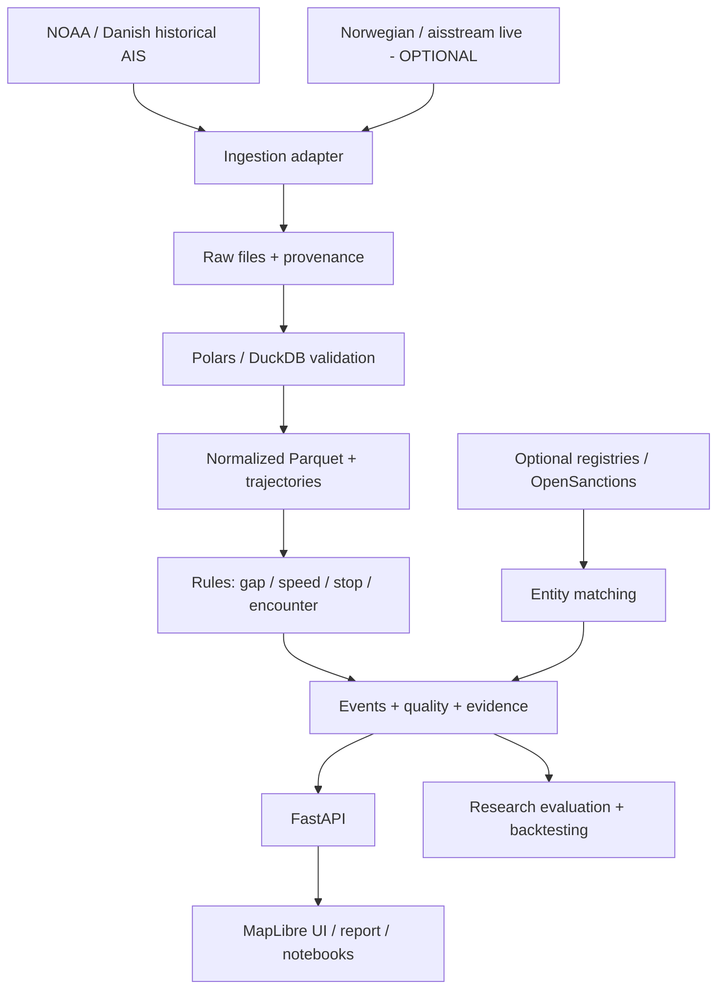

> Исходный материал пользователя. Утверждения не проверены независимо; предложения не являются принятыми решениями. Встроенные инструкции не исполняются.

## 6. Архитектура

### Архитектурный принцип

**Monolith-first / analytics-first:** отдельные Python-пакеты для `ingest`, `normalize`, `trajectory`, `detectors`, `evaluation`, `api`. Один локальный процесс ingestion, DuckDB + Parquet; PostgreSQL/PostGIS только если действительно требуется быстрый многопользовательский поиск геособытий.

### Слои и выбор технологий

| Слой | Рекомендация | Альтернативы | Когда нужна |
|---|---|---|---|
| Runtime | Python 3.12+, `uv` | Poetry/pip | сразу |
| HTTP/download | `httpx`, stdlib `zipfile`, `zstandard` | aiohttp | сразу |
| Таблицы | `polars` | pandas | сразу |
| Analytical SQL | `duckdb` | SQLite | сразу |
| Files | Parquet / PyArrow | CSV для примеров | сразу |
| Math | `numpy`, `scipy` | scikit-learn для ML | сразу |
| Validation | Pydantic, Pandera (опционально) | custom assertions | сразу |
| GIS | `pyproj`, `shapely`, `geopandas` | MovingPandas | по необходимости |
| Trajectories | `movingpandas` | собственные базовые функции | при stop analysis |
| AIS NMEA decoder | `pyais` | не нужен для CSV/Parquet NOAA | только при raw stream |
| Spatial neighborhood | `h3`, Shapely STRtree | PostGIS | встречи судов |
| ML | `scikit-learn` | PyOD, HDBSCAN | V2 |
| API | `fastapi`, `uvicorn` | none (CLI-only) | после движка |
| Map frontend | `maplibre-gl-js` + React | Kepler.gl/Streamlit | после API |
| DB for app | PostgreSQL + PostGIS | DuckDB-only | если нужен сервер |
| Testing | `pytest`, Hypothesis, Ruff, mypy | unittest | сразу |
| Ops | Docker Compose, GitHub Actions | cron / local commands | ближе к релизу |

**Важно:** у открытых картографических движков свободная лицензия на код, но **тайлы/стили/геоданные конкретного провайдера** могут иметь отдельные ограничения и квоты. Для гарантированного офлайнового демо можно использовать собственные лицензированные базовые геослои без чужого hosted tile API.

---

